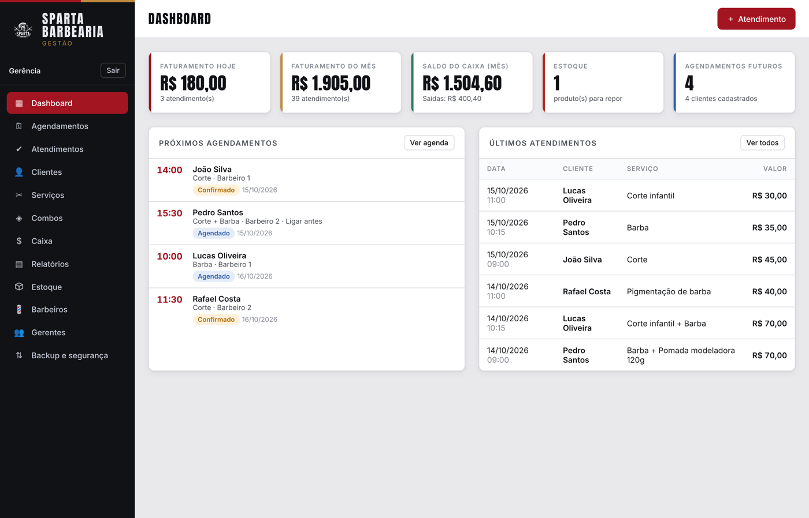
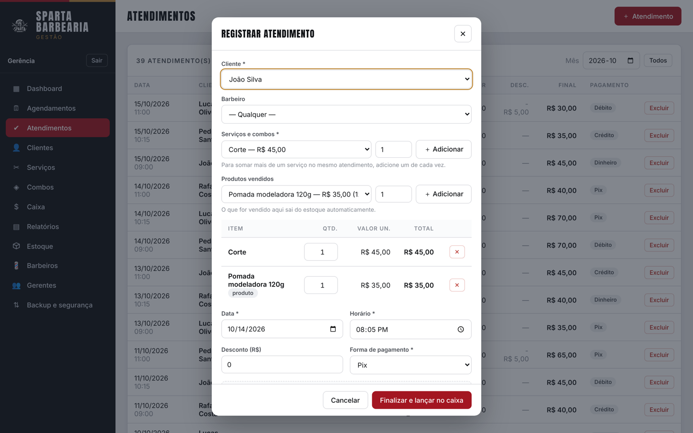
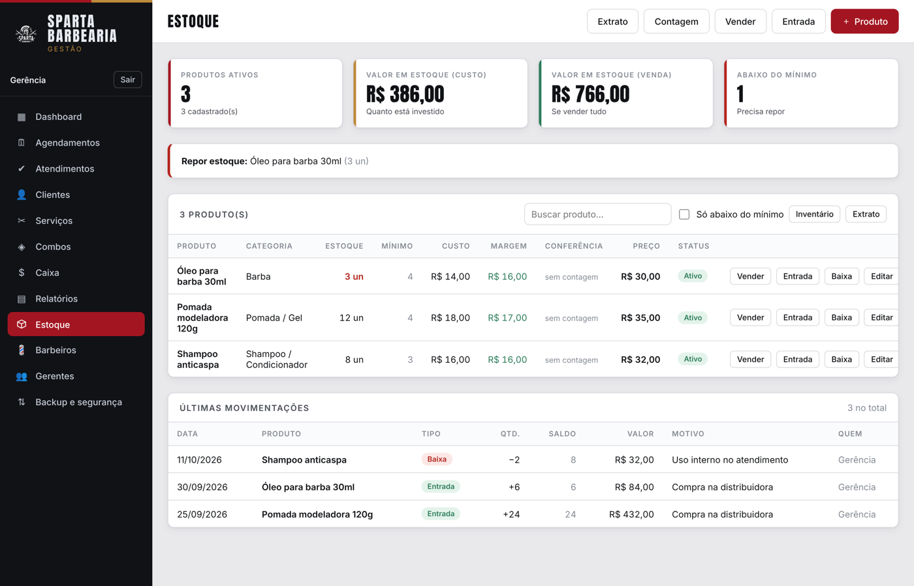
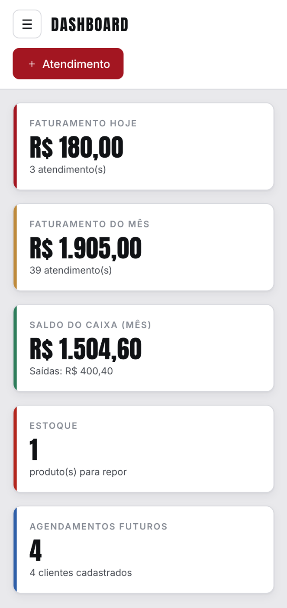
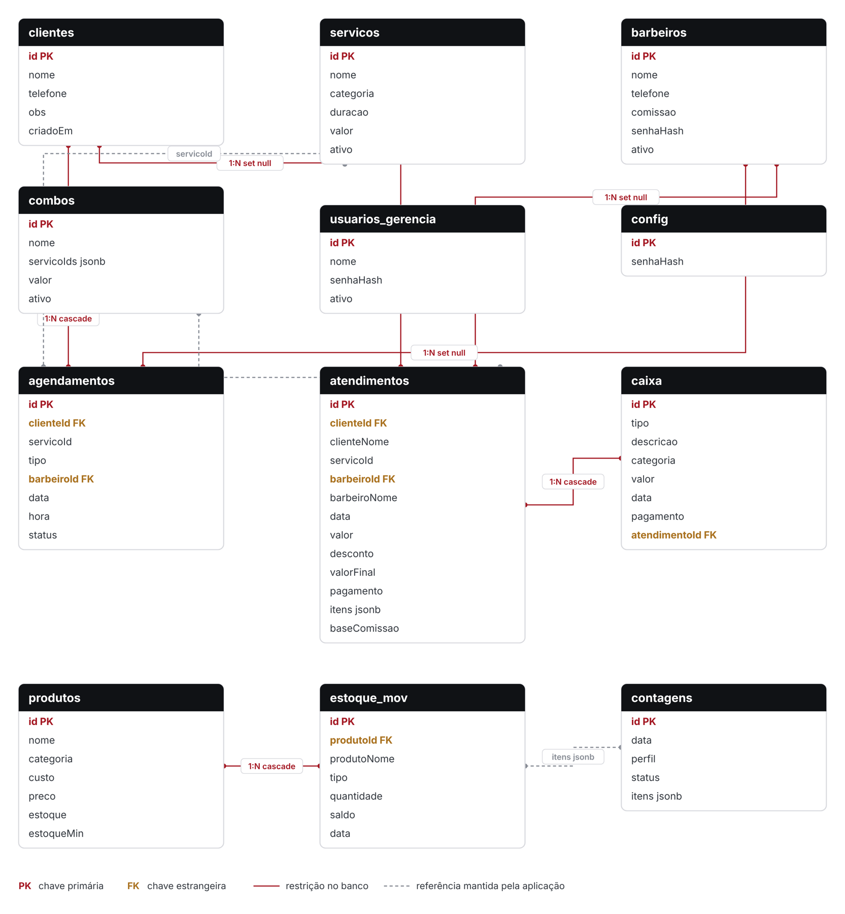

# Sparta Barbearia — Sistema Web de Gestão

Aplicação web de gestão desenvolvida para a **Sparta Barbearia**, microempreendimento do setor de
beleza masculina de Campo Grande/MS, como **ação de extensão universitária** do Programa UFMS Digital.

O sistema substitui o controle manual em papel — agenda de horários, caderno de atendimentos e
conferência de caixa feita de memória — por um registro digital integrado, acessível pelo navegador
no computador do estabelecimento e no celular, com os dados sincronizados entre os dois.



---

## Funcionalidades

| Módulo | O que faz |
|---|---|
| **Agendamentos** | Marcação de horários por cliente, serviço e profissional, com verificação de conflito de horário |
| **Atendimentos** | Lançamento da comanda com **vários serviços e produtos no mesmo atendimento**, desconto e forma de pagamento |
| **Clientes** | Cadastro com telefone, observações e histórico de atendimentos |
| **Serviços e combos** | Cadastro de preços e duração, preservando o valor histórico dos atendimentos já lançados |
| **Caixa** | Entradas geradas automaticamente pelos atendimentos concluídos e lançamento manual de despesas |
| **Estoque** | Produtos de venda com baixa automática, alerta de reposição, contagem às cegas com aprovação gerencial e extrato de movimentações |
| **Relatórios** | Faturamento por período, ticket médio, desempenho por profissional, serviço, cliente e forma de pagamento |
| **Comissões** | Cálculo por profissional sobre a base de serviços, exportável em PDF e em planilha |
| **Backup** | Exportação e importação de todos os dados em JSON |

O acesso é separado em dois perfis: **barbeiro**, que alcança apenas as telas operacionais, e
**gerência**, que acessa caixa, relatórios, cadastro de profissionais e backup.

<p align="center">
  
  
</p>

---

## Tecnologias

- **HTML5** com marcação semântica (`header`, `nav`, `main`, `aside`) e recursos de acessibilidade
- **CSS3** com variáveis personalizadas, Flexbox, CSS Grid e *media queries*
- **JavaScript (ES6+)**, sem framework e sem etapa de compilação
- **[Supabase](https://supabase.com)** — banco de dados PostgreSQL gerenciado em nuvem, acessado pela
  biblioteca oficial `supabase-js`

### Por que sem framework?

A decisão foi deliberada e decorre do contexto da ação de extensão. A aplicação precisa ser aberta
diretamente no navegador do estabelecimento, sem servidor de aplicação e sem processo de *build*, de
modo que a equipe da barbearia permaneça autônoma após o encerramento da ação. O escopo é pequeno e
bem delimitado, e um framework acrescentaria uma cadeia de dependências desproporcional ao problema.
A organização do código é garantida pela **separação em arquivos por responsabilidade**, descrita
adiante.

---

## Estrutura do projeto

```
├── index.html          Página única da aplicação
├── style.css           Estilos, tokens de design e regras responsivas
├── supabase.js         Conexão com o banco de dados em nuvem
├── seguranca.js        Resumo criptográfico de senhas (SHA-256) e conferência de acesso
├── app.js              Camada de dados, perfis de acesso, telas e regras de negócio
├── estoque.js          Produtos, movimentações, contagem e extrato
├── relatorios.js       Apuração de faturamento e cálculo de comissões
├── export.js           Geração dos arquivos .xlsx e dos relatórios em PDF
├── logo.js             Logomarca vetorizada em SVG
├── sql/                Migrações do banco de dados, aditivas e numeradas
└── docs/               Manual ilustrado de uso e imagens das telas
```

---

## Como executar localmente

### 1. Criar o banco de dados

1. Crie uma conta gratuita em [supabase.com](https://supabase.com) e um novo projeto.
2. No painel do Supabase, abra **SQL Editor → New query**.
3. Execute os arquivos da pasta `sql/` **na ordem numérica**, um de cada vez:

   ```
   sql/00-schema.sql             → estrutura completa: tabelas, chaves e índices
   sql/01-estoque.sql            → produtos e movimentações de estoque
   sql/02-atendimento-itens.sql  → atendimento com vários serviços e produtos
   sql/03-contagens.sql          → contagens de estoque com aprovação
   ```

   O prefixo numérico define a ordem de execução. As migrações são **aditivas**: apenas
   acrescentam colunas e tabelas, sem apagar dados existentes, e podem ser reexecutadas sem
   efeito colateral.

   O arquivo `sql/consultas-exemplo.sql` não é uma migração — insere dados fictícios e roda as
   consultas dos relatórios para conferir o esquema em um banco de testes.

### 2. Configurar a conexão

Em **Project Settings → API**, copie a *URL* e a *publishable key* do projeto e informe-as no arquivo
`supabase.js`:

```js
const SUPABASE_URL = 'https://SEU-PROJETO.supabase.co';
const SUPABASE_ANON_KEY = 'SUA-CHAVE-PUBLICAVEL';
```

> A chave publicável é projetada para ficar visível no código do navegador — ela não dá acesso
> administrativo. A proteção efetiva dos dados vem das políticas de **Row Level Security (RLS)**
> configuradas no próprio Supabase, que devem ser revisadas antes de colocar o sistema em uso real.

### 3. Abrir a aplicação

Abra o arquivo `index.html` no navegador. Não há instalação, dependências para baixar nem etapa de
compilação.

Para servir por HTTP local, se preferir:

```bash
python3 -m http.server 8000
# depois acesse http://localhost:8000
```

### 4. Primeiro acesso

Na tela inicial, escolha **Gerência barbearia**. No primeiro uso o sistema pede o cadastro da senha
gerencial. Depois disso, cadastre os barbeiros na aba **Barbeiros** — cada um recebe a própria senha
de acesso.

---

## Acessibilidade

- Idioma declarado no documento (`lang="pt-BR"`)
- Marcação semântica com regiões identificáveis: `header`, `nav`, `main`, `aside`
- Link **"Pular para o conteúdo"**, primeiro na ordem de tabulação
- Todos os botões possuem nome acessível; ícones decorativos ficam ocultos ao leitor de tela
  (`aria-hidden`)
- Janelas de formulário anunciadas como diálogo (`role="dialog"`, `aria-modal`)
- Avisos do sistema lidos sem roubar o foco (`role="status"`, `aria-live="polite"`)
- Estado do menu lateral informado por `aria-expanded`
- Indicador de foco visível para navegação por teclado (`:focus-visible`)
- Animações desativadas para quem solicita menos movimento (`prefers-reduced-motion`)

## Responsividade

O layout emprega unidades relativas, Flexbox, CSS Grid e pontos de quebra, e foi verificado a partir
de **360 px** de largura sem rolagem horizontal em nenhuma tela. Em telas estreitas o menu lateral
recolhe atrás de um botão, as colunas se empilham e as tabelas largas rolam dentro da própria área,
sem arrastar a página.

<p align="center">
  
</p>

---

## Modelo de dados

O banco tem doze tabelas, divididas entre cadastros, operação e estoque. As chaves estrangeiras
seguem duas regras, conforme o que deve acontecer ao excluir um registro: excluir um cliente
remove seus agendamentos futuros (`cascade`), mas **preserva o histórico de atendimentos**
(`set null`), que guarda o nome copiado no momento do atendimento. Excluir um atendimento remove a
entrada correspondente no caixa (`cascade`), para que faturamento e caixa nunca divirjam.



O arquivo [`sql/00-schema.sql`](sql/00-schema.sql) traz a estrutura completa, com chaves, índices e
uma nota explicando as duas desnormalizações deliberadas do modelo.

---

## Documentação

- **[Manual ilustrado de uso](docs/Manual-Sparta-Barbearia.pdf)** — guia em PDF com imagens das telas
  e linguagem acessível, destinado à equipe da barbearia.
- **[Modelo de dados em SVG](docs/modelo-dados.svg)** — diagrama em vetor, para ampliar sem perda.

---

## Contexto acadêmico

Ação de extensão desenvolvida no **Programa de Extensão UFMS Digital (95DX7.200525)**, curso de
Tecnologia da Informação da Universidade Federal de Mato Grosso do Sul.

**Autora:** Adrielly Jarcem Rodrigues de Oliveira

---

## Licença

Distribuído sob a licença MIT. Veja [LICENSE](LICENSE).
